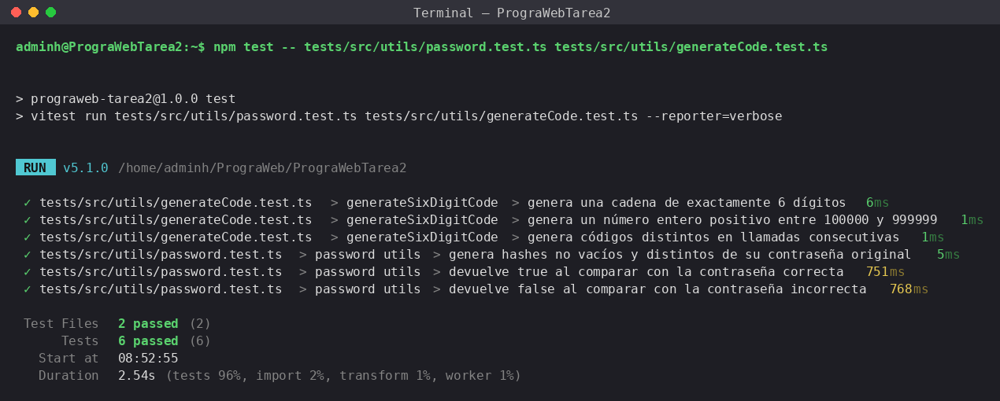

# Pruebas unitarias de utilitarios

Pruebas con **Vitest + TypeScript** para `password.util.ts` y `generateCode.util.ts`.

## Ejecutar

```bash
npm install
npm test -- tests/src/utils/password.test.ts tests/src/utils/generateCode.test.ts
```

## Evidencia



Salida en texto: [evidencia/salida-tests.txt](evidencia/salida-tests.txt)
